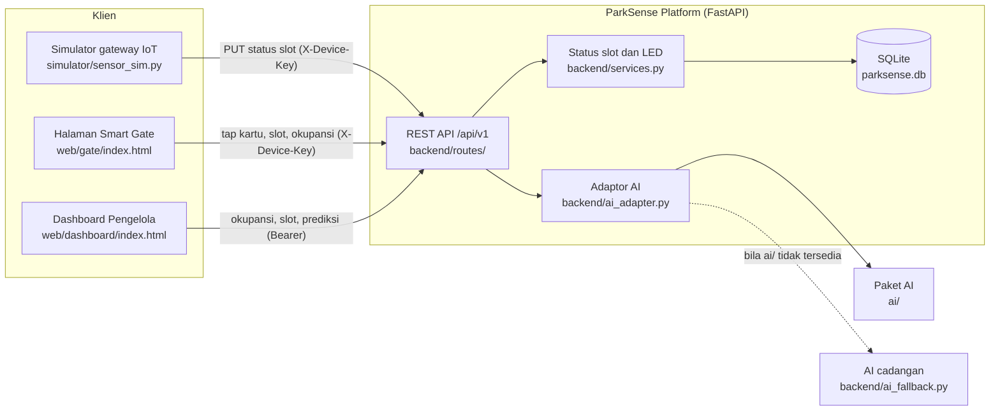

# 3 Implementasi Prototipe

## 3.1 Gambaran Umum Prototipe

Deliverable 3 mewujudkan rancangan layanan ParkSense dari Deliverable 2 menjadi prototipe yang dapat dijalankan, didemokan, dan diuji. Prototipe ini difokuskan pada alur yang menjawab lima masalah utama, yaitu lokasi slot kosong yang tidak diketahui (P1), tidak adanya petunjuk visual menuju slot (P2), tidak tersedianya data okupansi bagi pengelola (P3), penggunaan lantai yang tidak merata (P4), dan pengawasan area parkir yang masih manual (P5). Prioritas pengerjaan diletakkan pada demo dan bukti uji, bukan pada kelengkapan fitur.

Ruang lingkup prototipe mencakup gedung parkir motor dengan dua lantai, masing-masing berisi 20 slot dengan ID berformat `F{lantai}-A{01..20}`, misalnya `F2-A17`. Pada kondisi awal, lantai 1 dibuka dan lantai 2 (lantai atas) ditutup, sesuai temuan bahwa lantai atas sering ditutup walaupun lantai bawah sudah padat. Lantai 2 dibuka oleh skenario uji jam puncak dan skenario penuh.

Seluruh prototipe berjalan secara virtual di satu laptop tanpa perangkat fisik. Elemen fisik pada rancangan layanan digantikan oleh perangkat lunak seperti ditunjukkan pada Tabel 3.1.1.

Tabel 3.1.1 Elemen fisik dan realisasinya di prototipe

| Elemen pada rancangan | Realisasi di prototipe |
|---|---|
| Sensor ultrasonik per slot | Nilai jarak (cm) yang dibangkitkan simulator: terisi 10–25 cm, kosong 80–200 cm, rusak 500 cm |
| *Gateway* ESP32 per lantai | Skrip simulator dengan `gatewayId` `ESP32-GW-F1` dan `ESP32-GW-F2` |
| LED penunjuk slot | Warna pada panel terminal simulator dan pada peta slot halaman gerbang |
| Pembaca kartu RFID di gerbang | Isian `cardId` pada halaman Smart Gate |
| Data okupansi historis | Data simulasi 14 hari kerja × 24 jam × 2 lantai (`ai/history.json`) |

Walaupun perangkatnya disimulasikan, antarmuka antara perangkat dan platform tidak disederhanakan. Simulator dan halaman gerbang memanggil *endpoint* REST API dengan *header*, *payload*, dan bentuk respons yang sama persis dengan yang akan dipakai perangkat nyata. Dengan demikian, platform tidak dapat membedakan simulator dari perangkat sungguhan, dan penggantian ke ESP32 fisik hanya mengubah sisi klien tanpa mengubah *backend*.

## 3.2 Arsitektur Sistem

### 3.2.1 Komponen dan Hubungannya

Prototipe terdiri atas satu platform *backend* dan tiga klien. Ketiga klien hanya berkomunikasi dengan platform melalui REST API ber-*prefix* `/api/v1`. Platform memakai paket AI sebagai pustaka Python yang dipanggil langsung, bukan sebagai layanan terpisah.

**[Sisipkan Gambar 3.2.1: ekspor diagram mermaid di atas]**

Gambar 3.2.1 Arsitektur komponen prototipe ParkSense

Gambar 3.2.1 menunjukkan bahwa setiap klien memakai kredensial sesuai perannya. Simulator dan halaman gerbang bertindak sebagai perangkat, sedangkan *dashboard* bertindak sebagai pengguna pengelola. Di sisi platform, *route* menerima permintaan, `services.py` mengelola status slot dan warna LED di SQLite, dan `ai_adapter.py` meneruskan pemanggilan AI ke paket `ai/` atau ke implementasi cadangan. Halaman gerbang dan dashboard juga disajikan oleh *backend* yang sama sebagai berkas statis di `/web`, sehingga seluruh prototipe dijalankan dengan satu perintah.

Tabel 3.2.1 merinci peran tiap komponen beserta berkas utamanya.

Tabel 3.2.1 Komponen prototipe dan berkas utama

| Komponen | Peran | Berkas utama |
|---|---|---|
| REST API | Menerima permintaan klien, memeriksa otorisasi dan *payload*, mengembalikan respons atau galat seragam | `backend/main.py`, `backend/routes/` (`gate.py`, `slots.py`, `occupancy.py`, `predictions.py`, `dev.py`) |
| Logika status slot dan LED | Menentukan warna LED, menandai sensor basi, menghitung ringkasan per lantai | `backend/services.py` |
| Penyimpanan | Menyimpan lantai, slot, kartu valid, catatan masuk, dan bacaan sensor; mengisi data awal | `backend/db.py` |
| Otorisasi dan galat | Memeriksa `X-Device-Key` dan *Bearer token*; menyeragamkan format galat | `backend/auth.py`, `backend/errors.py` |
| Adaptor AI | Memilih fungsi dari paket `ai/` atau dari cadangan, per fungsi | `backend/ai_adapter.py`, `backend/ai_fallback.py` |
| Paket AI | Rekomendasi slot, prediksi okupansi dan *advisory*, deteksi anomali sensor, data historis | `ai/recommend.py`, `ai/predict.py`, `ai/anomaly.py`, `ai/seed_history.py` |
| Simulator IoT | Berperan sebagai *gateway* ESP32 dan sensor ultrasonik, menampilkan LED virtual, mengirim *heartbeat*, menjalankan skenario uji | `simulator/sensor_sim.py`, `simulator/config.py`, `simulator/scenarios/` |
| Smart Gate | Tap kartu, layar gerbang, status palang, peta slot dengan LED virtual | `web/gate/index.html` |
| Dashboard Pengelola | Okupansi per lantai, peringatan sensor, grafik prediksi dan *advisory* | `web/dashboard/index.html` |

Basis data SQLite berisi lima tabel. Tabel `floors` dan `slots` menyimpan kondisi gedung, termasuk status slot, warna LED, waktu laporan terakhir (`last_update`), dan waktu slot direkomendasikan (`recommended_at`). Tabel `cards` menyimpan kartu valid, `entries` mencatat setiap tap masuk, dan `readings` mencatat setiap bacaan sensor yang diterima.

### 3.2.2 Teknologi yang Digunakan

Pemilihan teknologi mengutamakan kesederhanaan agar prototipe mudah dijalankan dan dijelaskan. Seluruh komponen berbasis Python atau HTML biasa tanpa proses *build*, seperti dirangkum pada Tabel 3.2.2.

Tabel 3.2.2 Teknologi prototipe

| Lapisan | Teknologi | Keterangan |
|---|---|---|
| *Backend* | Python 3.11+, FastAPI, uvicorn | REST API; dokumentasi OpenAPI otomatis di `/docs` dan diekspor ke `docs/openapi.json` |
| Validasi data | Pydantic (bawaan FastAPI) | Memeriksa kelengkapan dan tipe *payload* |
| Penyimpanan | SQLite (modul `sqlite3` bawaan Python) | Satu berkas `parksense.db`; basis data di memori untuk pengujian |
| AI | Python murni tanpa pustaka *machine learning* | Aturan berbobot dan rata-rata historis |
| Simulator IoT | Python dan pustaka `requests` | LED virtual berupa panel berwarna di terminal |
| Antarmuka web | HTML, CSS, dan JavaScript tanpa *framework* | Chart.js 4.4.1 dari CDN untuk grafik prediksi di dashboard |
| Pengujian | pytest dan `TestClient` FastAPI | Tes API, tes paket AI, dan tes simulator |

### 3.2.3 Endpoint Inti dan Pendukung

Empat *endpoint* inti mewujudkan layanan pada rancangan SoaML. *Endpoint* pendukung ditambahkan di luar kontrak inti untuk menampilkan peta slot, memuat kondisi uji, dan memeriksa kesehatan sistem. Tabel 3.2.3 merangkum seluruh *endpoint* dengan *base URL* `http://localhost:8000/api/v1`.

Tabel 3.2.3 Endpoint prototipe

| Metode dan path | Kategori | Klien | Otorisasi | Fungsi |
|---|---|---|---|---|
| `POST /gate/entry-tap` | Inti | Smart Gate | `X-Device-Key` | Validasi kartu, catat masuk, minta rekomendasi, tentukan aksi palang |
| `PUT /slots/{slot_id}/status` | Inti | Gateway IoT (simulator) | `X-Device-Key` | Perbarui status slot, cek anomali, kembalikan perintah LED |
| `GET /occupancy/floors` | Inti | Smart Gate, Dashboard | `X-Device-Key` atau *Bearer* | Ringkasan `available`, `occupied`, `unknown` per lantai |
| `GET /ai/predictions/occupancy` | Inti | Dashboard | *Bearer* | Prediksi okupansi per jam per lantai dan *advisory* |
| `GET /slots` | Pendukung | Smart Gate, Dashboard | `X-Device-Key` atau *Bearer* | Status dan warna LED seluruh slot |
| `POST /dev/scenario/{name}` | Pendukung | Simulator, penguji | `X-Device-Key` | Memuat kondisi `reset`, `peak_hour`, `all_full`, atau `sensor_stale` |
| `POST /dev/fault/recommendation` | Pendukung | Penguji | `X-Device-Key` | Memaksa modul rekomendasi gagal (`enabled=true`) atau memulihkannya (`enabled=false`) |
| `GET /health` | Pendukung | Penguji | Tanpa | Status layanan dan modul AI yang dipakai (`ai` atau `fallback`) |

`GET /health` berada di luar *prefix* `/api/v1`.

### 3.2.4 Keputusan Desain

Kontrak API dibekukan sejak awal pengerjaan. Nama *field*, *path*, kode galat, dan bentuk respons ditetapkan lebih dulu sehingga *backend*, paket AI, simulator, halaman gerbang, dan dashboard dapat dikembangkan bersamaan terhadap kontrak yang sama. Seluruh JSON memakai penamaan *camelCase*, dan seluruh waktu memakai format ISO 8601 dengan zona `+07:00`.

Setiap galat dikembalikan dalam format seragam `{"status", "code", "message"}`, misalnya `{"status": 400, "code": "INVALID_CARD", "message": "..."}`. *Payload* yang tidak lengkap atau salah tipe juga diubah ke format ini dengan kode `INVALID_REQUEST`, sehingga klien cukup membaca satu bentuk galat. Galat `RECOMMENDATION_FAILED` membawa *field* tambahan `gateAction`, `displayMessage`, dan `floors`, agar gerbang tetap dapat membuka palang dan menampilkan ketersediaan per lantai.

Otorisasi dibedakan menurut jenis klien. Perangkat, yaitu *gateway* IoT dan Smart Gate, memakai *header* `X-Device-Key`, sedangkan dashboard pengelola memakai `Authorization: Bearer`. Kunci yang tidak ada atau salah menghasilkan 401 `UNAUTHORIZED`, dan nilai kunci hanya didefinisikan di `backend/auth.py` serta dapat diganti melalui variabel lingkungan.

Modul AI dihubungkan melalui adaptor dengan mekanisme cadangan (*fallback*). `ai_adapter.py` mencoba mengimpor setiap fungsi dari paket `ai/` secara terpisah; bila suatu fungsi tidak tersedia, dipakai implementasi sederhana di `ai_fallback.py` dengan tanda tangan yang sama. Pada prototipe akhir, `GET /health` menunjukkan bahwa keenam fungsi memakai paket `ai/`.
