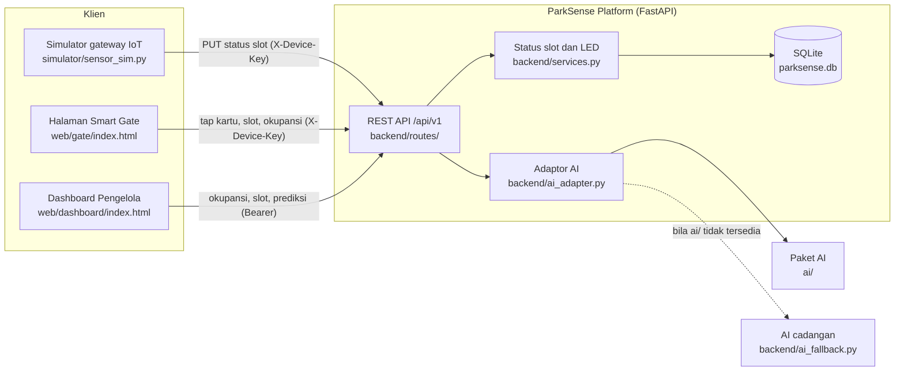
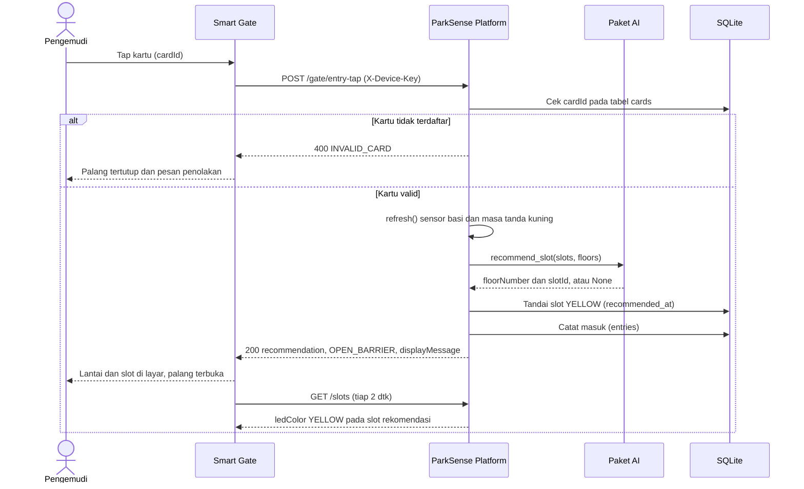
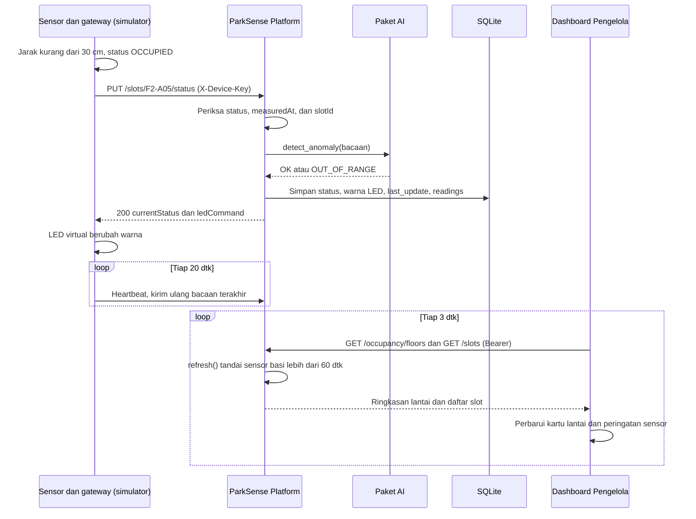

# 3 Implementasi Prototipe

## 3.1 Gambaran Umum Prototipe

Deliverable 3 mewujudkan rancangan layanan ParkSense dari Deliverable 2 menjadi prototipe yang dapat dijalankan, didemokan, dan diuji. Prototipe ini difokuskan pada alur yang menjawab lima masalah utama, yaitu lokasi slot kosong yang tidak diketahui (P1), tidak adanya petunjuk visual menuju slot (P2), tidak tersedianya data okupansi bagi pengelola (P3), penggunaan lantai yang tidak merata (P4), dan pengawasan area parkir yang masih manual (P5). Prioritas pengerjaan diletakkan pada demo dan bukti uji, bukan pada kelengkapan fitur.

Ruang lingkup prototipe mencakup gedung parkir motor dengan dua lantai, masing-masing berisi 20 slot dengan ID berformat `F{lantai}-A{01..20}`, misalnya `F2-A17`. Pada kondisi awal, lantai 1 dibuka dan lantai 2 (lantai atas) ditutup, sesuai temuan bahwa lantai atas sering ditutup walaupun lantai bawah sudah padat. Lantai 2 dibuka oleh skenario uji jam puncak dan skenario penuh.

Seluruh prototipe berjalan secara virtual di satu laptop tanpa perangkat fisik. Elemen fisik pada rancangan layanan digantikan oleh perangkat lunak seperti ditunjukkan pada Tabel 3.1.1.

Tabel 3.1.1 Elemen fisik dan realisasinya di prototipe

| Elemen pada rancangan | Realisasi di prototipe |
|---|---|
| Sensor ultrasonik per slot | Nilai jarak (cm) yang dibangkitkan simulator: terisi 10–25 cm, kosong 80–200 cm, rusak 500 cm |
| *Gateway* ESP32 per lantai | Skrip simulator dengan `gatewayId` `ESP32-GW-F1` dan `ESP32-GW-F2` |
| LED penunjuk slot | Warna pada panel terminal simulator dan pada peta slot halaman gerbang |
| Pembaca kartu RFID di gerbang | Isian `cardId` pada halaman Smart Gate |
| Data okupansi historis | Data simulasi 14 hari kerja × 24 jam × 2 lantai (`ai/history.json`) |

Walaupun perangkatnya disimulasikan, antarmuka antara perangkat dan platform tidak disederhanakan. Simulator dan halaman gerbang memanggil *endpoint* REST API dengan *header*, *payload*, dan bentuk respons yang sama persis dengan yang akan dipakai perangkat nyata. Dengan demikian, platform tidak dapat membedakan simulator dari perangkat sungguhan, dan penggantian ke ESP32 fisik hanya mengubah sisi klien tanpa mengubah *backend*.

## 3.2 Arsitektur Sistem

### 3.2.1 Komponen dan Hubungannya

Prototipe terdiri atas satu platform *backend* dan tiga klien. Ketiga klien hanya berkomunikasi dengan platform melalui REST API ber-*prefix* `/api/v1`. Platform memakai paket AI sebagai pustaka Python yang dipanggil langsung, bukan sebagai layanan terpisah.

**[Sisipkan Gambar 3.2.1: ekspor diagram mermaid di atas]**

Gambar 3.2.1 Arsitektur komponen prototipe ParkSense

Gambar 3.2.1 menunjukkan bahwa setiap klien memakai kredensial sesuai perannya. Simulator dan halaman gerbang bertindak sebagai perangkat, sedangkan *dashboard* bertindak sebagai pengguna pengelola. Di sisi platform, *route* menerima permintaan, `services.py` mengelola status slot dan warna LED di SQLite, dan `ai_adapter.py` meneruskan pemanggilan AI ke paket `ai/` atau ke implementasi cadangan. Halaman gerbang dan dashboard juga disajikan oleh *backend* yang sama sebagai berkas statis di `/web`, sehingga seluruh prototipe dijalankan dengan satu perintah.

Tabel 3.2.1 merinci peran tiap komponen beserta berkas utamanya.

Tabel 3.2.1 Komponen prototipe dan berkas utama

| Komponen | Peran | Berkas utama |
|---|---|---|
| REST API | Menerima permintaan klien, memeriksa otorisasi dan *payload*, mengembalikan respons atau galat seragam | `backend/main.py`, `backend/routes/` (`gate.py`, `slots.py`, `occupancy.py`, `predictions.py`, `dev.py`) |
| Logika status slot dan LED | Menentukan warna LED, menandai sensor basi, menghitung ringkasan per lantai | `backend/services.py` |
| Penyimpanan | Menyimpan lantai, slot, kartu valid, catatan masuk, dan bacaan sensor; mengisi data awal | `backend/db.py` |
| Otorisasi dan galat | Memeriksa `X-Device-Key` dan *Bearer token*; menyeragamkan format galat | `backend/auth.py`, `backend/errors.py` |
| Adaptor AI | Memilih fungsi dari paket `ai/` atau dari cadangan, per fungsi | `backend/ai_adapter.py`, `backend/ai_fallback.py` |
| Paket AI | Rekomendasi slot, prediksi okupansi dan *advisory*, deteksi anomali sensor, data historis | `ai/recommend.py`, `ai/predict.py`, `ai/anomaly.py`, `ai/seed_history.py` |
| Simulator IoT | Berperan sebagai *gateway* ESP32 dan sensor ultrasonik, menampilkan LED virtual, mengirim *heartbeat*, menjalankan skenario uji | `simulator/sensor_sim.py`, `simulator/config.py`, `simulator/scenarios/` |
| Smart Gate | Tap kartu, layar gerbang, status palang, peta slot dengan LED virtual | `web/gate/index.html` |
| Dashboard Pengelola | Okupansi per lantai, peringatan sensor, grafik prediksi dan *advisory* | `web/dashboard/index.html` |

Basis data SQLite berisi lima tabel. Tabel `floors` dan `slots` menyimpan kondisi gedung, termasuk status slot, warna LED, waktu laporan terakhir (`last_update`), dan waktu slot direkomendasikan (`recommended_at`). Tabel `cards` menyimpan kartu valid, `entries` mencatat setiap tap masuk, dan `readings` mencatat setiap bacaan sensor yang diterima.

### 3.2.2 Teknologi yang Digunakan

Pemilihan teknologi mengutamakan kesederhanaan agar prototipe mudah dijalankan dan dijelaskan. Seluruh komponen berbasis Python atau HTML biasa tanpa proses *build*, seperti dirangkum pada Tabel 3.2.2.

Tabel 3.2.2 Teknologi prototipe

| Lapisan | Teknologi | Keterangan |
|---|---|---|
| *Backend* | Python 3.11+, FastAPI, uvicorn | REST API; dokumentasi OpenAPI otomatis di `/docs` dan diekspor ke `docs/openapi.json` |
| Validasi data | Pydantic (bawaan FastAPI) | Memeriksa kelengkapan dan tipe *payload* |
| Penyimpanan | SQLite (modul `sqlite3` bawaan Python) | Satu berkas `parksense.db`; basis data di memori untuk pengujian |
| AI | Python murni tanpa pustaka *machine learning* | Aturan berbobot dan rata-rata historis |
| Simulator IoT | Python dan pustaka `requests` | LED virtual berupa panel berwarna di terminal |
| Antarmuka web | HTML, CSS, dan JavaScript tanpa *framework* | Chart.js 4.4.1 dari CDN untuk grafik prediksi di dashboard |
| Pengujian | pytest dan `TestClient` FastAPI | Tes API, tes paket AI, dan tes simulator |

### 3.2.3 Endpoint Inti dan Pendukung

Empat *endpoint* inti mewujudkan layanan pada rancangan SoaML. *Endpoint* pendukung ditambahkan di luar kontrak inti untuk menampilkan peta slot, memuat kondisi uji, dan memeriksa kesehatan sistem. Tabel 3.2.3 merangkum seluruh *endpoint* dengan *base URL* `http://localhost:8000/api/v1`.

Tabel 3.2.3 Endpoint prototipe

| Metode dan path | Kategori | Klien | Otorisasi | Fungsi |
|---|---|---|---|---|
| `POST /gate/entry-tap` | Inti | Smart Gate | `X-Device-Key` | Validasi kartu, catat masuk, minta rekomendasi, tentukan aksi palang |
| `PUT /slots/{slot_id}/status` | Inti | Gateway IoT (simulator) | `X-Device-Key` | Perbarui status slot, cek anomali, kembalikan perintah LED |
| `GET /occupancy/floors` | Inti | Smart Gate, Dashboard | `X-Device-Key` atau *Bearer* | Ringkasan `available`, `occupied`, `unknown` per lantai |
| `GET /ai/predictions/occupancy` | Inti | Dashboard | *Bearer* | Prediksi okupansi per jam per lantai dan *advisory* |
| `GET /slots` | Pendukung | Smart Gate, Dashboard | `X-Device-Key` atau *Bearer* | Status dan warna LED seluruh slot |
| `POST /dev/scenario/{name}` | Pendukung | Simulator, penguji | `X-Device-Key` | Memuat kondisi `reset`, `peak_hour`, `all_full`, atau `sensor_stale` |
| `POST /dev/fault/recommendation` | Pendukung | Penguji | `X-Device-Key` | Memaksa modul rekomendasi gagal (`enabled=true`) atau memulihkannya (`enabled=false`) |
| `GET /health` | Pendukung | Penguji | Tanpa | Status layanan dan modul AI yang dipakai (`ai` atau `fallback`) |

`GET /health` berada di luar *prefix* `/api/v1`.

### 3.2.4 Keputusan Desain

Kontrak API dibekukan sejak awal pengerjaan. Nama *field*, *path*, kode galat, dan bentuk respons ditetapkan lebih dulu sehingga *backend*, paket AI, simulator, halaman gerbang, dan dashboard dapat dikembangkan bersamaan terhadap kontrak yang sama. Seluruh JSON memakai penamaan *camelCase*, dan seluruh waktu memakai format ISO 8601 dengan zona `+07:00`.

Setiap galat dikembalikan dalam format seragam `{"status", "code", "message"}`, misalnya `{"status": 400, "code": "INVALID_CARD", "message": "..."}`. *Payload* yang tidak lengkap atau salah tipe juga diubah ke format ini dengan kode `INVALID_REQUEST`, sehingga klien cukup membaca satu bentuk galat. Galat `RECOMMENDATION_FAILED` membawa *field* tambahan `gateAction`, `displayMessage`, dan `floors`, agar gerbang tetap dapat membuka palang dan menampilkan ketersediaan per lantai.

Otorisasi dibedakan menurut jenis klien. Perangkat, yaitu *gateway* IoT dan Smart Gate, memakai *header* `X-Device-Key`, sedangkan dashboard pengelola memakai `Authorization: Bearer`. Kunci yang tidak ada atau salah menghasilkan 401 `UNAUTHORIZED`, dan nilai kunci hanya didefinisikan di `backend/auth.py` serta dapat diganti melalui variabel lingkungan.

Modul AI dihubungkan melalui adaptor dengan mekanisme cadangan (*fallback*). `ai_adapter.py` mencoba mengimpor setiap fungsi dari paket `ai/` secara terpisah; bila suatu fungsi tidak tersedia, dipakai implementasi sederhana di `ai_fallback.py` dengan tanda tangan yang sama. Pada prototipe akhir, `GET /health` menunjukkan bahwa keenam fungsi memakai paket `ai/`.

## 3.3 Alur Layanan Utama

Alur layanan prototipe mengikuti lima tahap BPMN To-Be pada Gambar 2.1.2, yaitu kedatangan, tap kartu dan rekomendasi, menuju slot, memarkir, serta keluar dan bayar. Dua alur diwujudkan secara utuh: tap kartu hingga LED kuning menyala, dan laporan sensor hingga perubahan tampil di *dashboard*. Tahap keluar dan bayar tetap memakai sistem yang sudah berjalan di gedung parkir sehingga berada di luar lingkup prototipe.

### 3.3.1 Tap Kartu hingga LED Kuning

**[Sisipkan Gambar 3.3.1: ekspor diagram mermaid di atas]**

Gambar 3.3.1 Diagram urutan tap kartu hingga LED kuning

Gambar 3.3.1 menunjukkan bahwa satu permintaan `POST /gate/entry-tap` mencakup validasi kartu, pencatatan masuk, rekomendasi AI, dan penandaan LED sekaligus. Cabang kartu tidak terdaftar berhenti di platform tanpa memanggil AI. Kasus rekomendasi kosong dan modul AI gagal dibahas pada Subbab 3.4.

Tahap kedatangan diawali aktivitas "Antre & tiba di gerbang" dan "Tap kartu di pembaca". Karena pembaca kartu disimulasikan, pengemudi memasukkan `cardId` pada halaman Smart Gate lalu menekan tombol tap. Halaman kemudian menjalankan "Baca kartu & minta rekomendasi" dengan mengirim `gateId` `GATE-IN-01`, `cardId`, `vehicleType` `MOTORCYCLE`, dan `tapTime` berzona `+07:00`.

Pada tahap tap kartu dan rekomendasi, platform menjalankan "Validasi kartu & catat masuk" dengan mencocokkan `cardId` ke tabel `cards`. Untuk kartu valid, "AI pilih lantai & slot" memanggil `recommend_slot` dengan daftar slot yang tidak sedang ditandai kuning untuk pengemudi lain, dan pemanggilan diulang dengan seluruh slot bila daftar itu tidak menghasilkan slot. Slot terpilih ditandai kuning melalui kolom `recommended_at` sebagai wujud aktivitas "Kirim perintah LED ke slot". Setiap tap juga dicatat di tabel `entries`.

Respons 200 berisi `recommendation`, `gateAction: "OPEN_BARRIER"`, dan `displayMessage`, misalnya `"Lantai 2 - Slot F2-A05"`. Halaman Smart Gate kemudian menjalankan "Buka palang, siapkan info lantai & slot" dan "Tampilkan di layar gerbang". Lantai dan slot ditampilkan, palang ditandai terbuka, dan slot tersebut disorot pada peta slot.

Pada tahap menuju slot, pengemudi menjalankan "Lihat informasi di layar gerbang" lalu "Menuju slot ikuti lampu LED". LED kuning terlihat pada peta slot halaman gerbang yang diperbarui tiap 2 detik dan pada panel LED simulator. Tanda kuning bertahan 120 detik (`RECOMMEND_TTL_SECONDS`), dan selama itu tap berikutnya tidak mendapat slot yang sama.

Rekomendasi bukan reservasi. Bila slot sudah diisi motor lain sebelum pengemudi tiba, laporan OCCUPIED dari sensor mengakhiri tanda kuning dan LED berubah merah. Pengemudi lalu menjalankan "Slot terisi: pilih slot lain ber-LED hijau".

### 3.3.2 Laporan Sensor hingga Dashboard

**[Sisipkan Gambar 3.3.2: ekspor diagram mermaid di atas]**

Gambar 3.3.2 Diagram urutan laporan sensor hingga dashboard

Gambar 3.3.2 memperlihatkan dua perulangan yang berjalan terpisah. Simulator mengirim laporan saat keadaan slot berubah dan mengirim ulang laporan terakhir sebagai *heartbeat*. *Dashboard* membaca hasilnya secara berkala tanpa berkomunikasi langsung dengan simulator.

Tahap memarkir diawali "Parkir di slot" dan "Deteksi kendaraan & kirim status". *Gateway* simulator mengubah jarak di bawah 30 cm menjadi OCCUPIED, lalu memanggil `PUT /slots/{slot_id}/status` dengan *payload* `gatewayId`, `sensorType`, `rawSensorValue`, `unit`, `status`, dan `measuredAt`. Saat motor keluar, aktivitas "Deteksi motor keluar slot & kirim status kosong" mengirim jarak 30 cm atau lebih dengan status AVAILABLE.

Platform menjalankan subproses "Perbarui status slot, LED & AI cek anomali" (Gambar 2.1.3). Kelengkapan data diperiksa lebih dulu, kemudian `detect_anomaly` memastikan jarak berada di rentang 2–400 cm. Status dan warna LED disimpan ke tabel `slots`, bacaan dicatat di tabel `readings`, dan respons mengembalikan `currentStatus` serta `ledCommand` sebagai wujud "Kirim perintah LED ke slot". Okupansi per lantai tidak disimpan terpisah, tetapi dihitung dari tabel `slots` setiap kali `GET /occupancy/floors` dipanggil.

Beberapa aktivitas direalisasikan berbeda dari rancangan. Aktivitas "Tentukan status dari jarak & simpan" dibagi antara *edge* dan platform: *gateway* menentukan status dari jarak karena ambang 30 cm paling dekat dengan sensor, sedangkan platform menerima status tersebut dan tetap memeriksa rentang nilai sensor. Selain itu, laporan AVAILABLE tidak menghapus tanda kuning, karena *heartbeat* mengirim ulang AVAILABLE tiap 20 detik dan akan memadamkan LED kuning sebelum pengemudi tiba. Tanda kuning baru dihapus saat slot menjadi OCCUPIED atau UNKNOWN, atau saat masa 120 detik habis.

Perintah LED juga tidak dikirim melalui MQTT, melainkan sebagai *field* `ledCommand` pada respons API yang dibaca simulator. Nilai `sent: true` berarti perintah sudah dibuat platform, bukan bukti perintah diterima perangkat fisik. Alur timer "Periksa lastUpdate tiap slot & masa tanda kuning" pun tidak dijalankan sebagai timer 30 detik, melainkan oleh fungsi `refresh()` setiap kali data slot atau okupansi dibaca. Karena halaman gerbang membaca tiap 2 detik dan *dashboard* tiap 3 detik, efek yang dilihat pengguna sama: slot basi menjadi UNKNOWN dan LED kuning kembali ke warna status slot.

Slot yang tidak melapor lebih dari 60 detik (`STALE_SECONDS`) ditandai UNKNOWN dengan LED OFF dan tanda kuningnya dihapus, sesuai aktivitas "Tandai UNKNOWN, LED OFF, keluarkan dari rekomendasi". Simulator mengirim *heartbeat* tiap 20 detik, lebih rapat dari batas 30 detik pada rancangan, sehingga sensor yang masih hidup tidak pernah dianggap basi. *Dashboard* membaca slot berstatus UNKNOWN dari `GET /slots` dan menampilkannya sebagai peringatan sensor bagi pengelola.

### 3.3.3 Prediksi Okupansi untuk Pengelola

Alur prediksi berjalan atas permintaan pengelola dari *dashboard*. *Dashboard* memanggil `GET /ai/predictions/occupancy` dengan parameter `fromHour` dan `toHour`, lalu platform memeriksa gateway "Rentang jam valid?" dengan syarat `0 ≤ fromHour < toHour ≤ 23`. Rentang yang valid diteruskan ke "AI prediksi okupansi per jam & susun advisory", dan hasilnya ditampilkan sebagai grafik per lantai beserta teks *advisory*. Rincian model dibahas pada Subbab 3.6.

### 3.3.4 Tahap Keluar dan Bayar

Aktivitas "Tap & bayar keluar", "Hitung tarif & proses bayar", "Buka palang keluar", dan "Catat keluar & rilis sesi" tidak diimplementasikan karena tarif dan pembayaran tetap memakai sistem yang sudah ada. Prototipe tidak memiliki *endpoint* keluar. Slot dikosongkan semata-mata oleh laporan sensor AVAILABLE, bukan oleh pencatatan sesi keluar.

## 3.4 Penanganan Galat pada Prototipe

Penanganan galat pada prototipe mengikuti jalur pengecualian di BPMN To-Be. Prinsip utamanya adalah palang tetap terbuka bagi kartu yang valid walaupun rekomendasi tidak tersedia, dan slot dengan sensor bermasalah tidak pernah direkomendasikan. Tabel 3.4.1 memetakan setiap kondisi galat ke perilaku prototipe, kode galat, aktivitas BPMN To-Be, dan bukti uji.

Tabel 3.4.1 Penanganan galat pada prototipe

| Kondisi | Perilaku prototipe | Endpoint dan kode | Aktivitas BPMN To-Be | Bukti |
|---|---|---|---|---|
| Kartu tidak terdaftar | Palang tidak dibuka; layar gerbang menampilkan "Kartu ditolak" | `POST /gate/entry-tap`, 400 `INVALID_CARD` | "Kartu valid?" (tidak); "Palang tetap tertutup, siapkan pesan penolakan" | TC-03 (pytest); [TODO: bukti tangkapan layar gerbang TC-03] |
| Tidak ada slot AVAILABLE di lantai terbuka | `recommendation: null`, palang tetap dibuka, layar menampilkan "Parkir penuh." dan ketersediaan per lantai | `POST /gate/entry-tap`, 200 | "Ada slot AVAILABLE di lantai terbuka?" (tidak); "Buka palang, siapkan info ketersediaan per lantai" | TC-02 (pytest); [TODO: bukti tangkapan layar gerbang TC-02] |
| Modul AI gagal | Palang tetap dibuka; respons membawa `gateAction`, `displayMessage`, dan `floors` | `POST /gate/entry-tap`, 500 `RECOMMENDATION_FAILED` | Kejadian "Modul AI gagal" pada "AI pilih lantai & slot"; "Buka palang, siapkan info ketersediaan per lantai" | TC-09 (pytest); [TODO: bukti tangkapan layar gerbang TC-09] |
| Gerbang tidak mendapat respons lebih dari 3 detik | Tidak ada timer 3 detik; bila koneksi gagal, layar menampilkan "Server tidak terjangkau" dan palang tidak dibuka | — | Timer "> 3 dtk tanpa respons"; "Pakai sistem kartu lama: buka palang, pesan umum" | Di luar lingkup prototipe |
| Kunci perangkat atau token salah atau tidak ada | Permintaan ditolak; *dashboard* menampilkan *banner* token tidak valid | Semua *endpoint* kecuali `/health`, 401 `UNAUTHORIZED` | "Periksa kunci perangkat & kelengkapan data" (tidak valid) | TC-07 (pytest); `dashboard/scenarios_dashboard_2026-11-24.txt` |
| Status sensor di luar AVAILABLE, OCCUPIED, UNKNOWN | Laporan ditolak, status slot tidak berubah | `PUT /slots/{slot_id}/status`, 400 `INVALID_STATUS` | "Periksa kunci perangkat & kelengkapan data" (tidak valid) | TC-08 (pytest) |
| *Payload* atau parameter tidak lengkap atau salah tipe, termasuk `measuredAt` bukan ISO 8601 | Permintaan ditolak | *Endpoint* dengan *body* atau parameter, 400 `INVALID_REQUEST` | "Periksa kunci perangkat & kelengkapan data" (tidak valid) | Uji kasus galat (pytest) |
| ID slot tidak dikenal | Laporan ditolak | `PUT /slots/{slot_id}/status`, 404 `SLOT_NOT_FOUND` | Tidak dimodelkan (validasi teknis) | Uji kasus galat (pytest) |
| Nama skenario tidak dikenal | Permintaan ditolak | `POST /dev/scenario/{name}`, 404 `SCENARIO_NOT_FOUND` | Tidak dimodelkan (validasi teknis) | [TODO: bukti SCENARIO_NOT_FOUND] |
| Nilai sensor di luar 2–400 cm | Slot menjadi UNKNOWN, LED OFF, keluar dari rekomendasi, dihitung pada `unknown`, muncul di peringatan *dashboard* | `PUT /slots/{slot_id}/status`, 200 dengan `anomaly: "OUT_OF_RANGE"` | "AI cek anomali pembacaan sensor" (OUT_OF_RANGE) | TC-05 (pytest); `dashboard/tc05_dashboard_2026-11-24.txt`; [TODO: bukti log runner TC-05 simulator] |
| Sensor tidak melapor lebih dari 60 detik | Slot menjadi UNKNOWN, LED OFF, keluar dari rekomendasi, muncul di peringatan *dashboard* | Terlihat pada `GET /slots` dan `GET /occupancy/floors` | "Periksa lastUpdate tiap slot & masa tanda kuning"; "Tandai UNKNOWN, LED OFF, keluarkan dari rekomendasi" | TC-05 (pytest); `dashboard/tc05_dashboard_2026-11-24.txt`; `dashboard/tc05_dashboard_unknown.png`; [TODO: bukti log runner TC-05 mode stale] |
| Gagal menyimpan ke basis data | Transaksi dibatalkan (*rollback*), status slot tidak berubah | `PUT /slots/{slot_id}/status`, 500 `DB_UPDATE_FAILED` | Kejadian "Gagal simpan DB" pada "Tentukan status dari jarak & simpan" | [TODO: bukti DB_UPDATE_FAILED; belum ada skenario uji] |
| Slot rekomendasi terisi motor lain | Tanda kuning berakhir, LED berubah merah | `PUT /slots/{slot_id}/status`, 200 | "Slot masih kosong?" (tidak); "Slot terisi: pilih slot lain ber-LED hijau" | TC-04 (pytest, LED merah saat OCCUPIED); [TODO: bukti slot kuning berubah merah saat terisi] |
| Rentang jam prediksi salah | *Dashboard* menampilkan kode dan pesan galat; grafik sebelumnya dipertahankan dengan keterangan | `GET /ai/predictions/occupancy`, 400 `INVALID_TIME_WINDOW` | "Rentang jam valid?" (tidak) | TC-06 (pytest); `dashboard/tc06_invalid_window.png` |
| Pembayaran keluar gagal | Tidak diimplementasikan | — | "Pembayaran berhasil?" (tidak); "Petugas tangani pembayaran (sistem lama)" | Di luar lingkup prototipe |

Keterangan bukti: "pytest" merujuk pada fungsi uji di `tests/api_tests/test_tc_api.py`, dengan hasil 13 tes lulus pada `tests/evidence/api-pytest-run.png`. Berkas berawalan `dashboard/` berada di `tests/evidence/dashboard/`.

Galat pada sisi gerbang dirancang agar pengemudi dengan kartu valid tidak tertahan. Respons 200 dengan `recommendation: null` dan respons 500 `RECOMMENDATION_FAILED` sama-sama membawa `gateAction: "OPEN_BARRIER"`, sehingga halaman gerbang membuka palang dan menampilkan ketersediaan per lantai. Hanya kartu yang tidak terdaftar yang membuat palang tetap tertutup.

Galat pada sisi sensor tidak ditolak, tetapi diubah menjadi status UNKNOWN. Dengan cara ini, slot bermasalah tetap terlihat oleh pengelola sebagai peringatan, tidak terhitung sebagai slot tersedia, dan tidak pernah dipilih oleh rekomendasi. Galat teknis seperti 404 dan `INVALID_REQUEST` tidak dimodelkan di BPMN karena hanya menyangkut validasi format permintaan.

## 3.5 Peran IoT

### 3.5.1 Simulator Gateway dan Sensor

Lapisan IoT pada prototipe diwujudkan oleh simulator `simulator/sensor_sim.py` yang berperan sebagai *gateway* ESP32 per lantai sekaligus sensor ultrasonik per slot. Setiap laporan dikirim ke `PUT /slots/{slot_id}/status` dengan *header* `X-Device-Key`, `gatewayId` `ESP32-GW-F1` atau `ESP32-GW-F2` sesuai lantai, dan `sensorType` `ULTRASONIC`. Alamat API, kunci perangkat, ambang sensor, dan interval *heartbeat* dikumpulkan di satu berkas, `simulator/config.py`, dan dapat diganti melalui variabel lingkungan.

Simulator menerapkan aturan sensor dari kontrak. Jarak di bawah 30 cm berarti ada motor (OCCUPIED), sedangkan jarak 30 cm atau lebih berarti kosong (AVAILABLE). Simulator membangkitkan jarak 10–25 cm untuk slot terisi dan 80–200 cm untuk slot kosong. Nilai di luar rentang valid 2–400 cm tetap dikirim apa adanya, sehingga deteksi anomali dilakukan di platform.

LED slot digantikan oleh panel berwarna di terminal yang menampilkan 40 slot dalam warna hijau, merah, kuning, atau abu-abu (OFF). Warna setiap slot diperbarui dari `ledCommand.color` pada respons `PUT`. Tanda kuning hasil tap kartu ditetapkan oleh platform tanpa laporan sensor, sehingga panel menyinkronkannya dari `GET /slots` melalui perintah `panel`.

### 3.5.2 Heartbeat

Platform menandai slot UNKNOWN bila tidak menerima laporan lebih dari 60 detik. Karena itu simulator menjalankan *thread* latar yang mengirim ulang bacaan terakhir setiap 20 detik untuk semua slot yang pernah melapor. Nilai 20 detik dipilih agar memenuhi batas maksimum 30 detik pada rancangan dengan selisih yang aman. Perintah `stop` mengeluarkan satu slot dari *heartbeat*, dan cara inilah yang dipakai untuk memicu sensor basi pada TC-05 tanpa memengaruhi slot lain.

### 3.5.3 Mode Simulator

Simulator menyediakan tiga mode yang dirangkum pada Tabel 3.5.1. Mode manual dipakai saat demo, mode otomatis dipakai untuk menunjukkan pola jam puncak, dan mode *fault* dipakai untuk menguji sensor bermasalah.

Tabel 3.5.1 Mode simulator IoT

| Mode | Cara menjalankan | Perilaku |
|---|---|---|
| Manual | `python -m simulator.sensor_sim manual` | Konsol interaktif: `set F2-A17 occupied` atau `free`, `stop`, `resume`, `glitch`, `scenario`, `panel`, `floors` |
| Otomatis | `python -m simulator.sensor_sim auto --speed 60 --start-hour 6` | Motor datang dan pergi secara acak mengikuti tabel kedatangan per jam yang memuncak pada pukul 07.00; `--speed 60` berarti 1 detik nyata sama dengan 1 menit simulasi; opsi `--tap` membuat setiap motor tap kartu dan parkir di slot rekomendasi |
| *Fault* | `python -m simulator.sensor_sim fault glitch F2-A17` atau `fault stop F2-A17` | `glitch` mengirim 500 cm sehingga slot menjadi UNKNOWN dengan `anomaly: "OUT_OF_RANGE"`; `stop` menghentikan *heartbeat* sehingga slot menjadi UNKNOWN setelah lebih dari 60 detik |

Selain ketiga mode tersebut, simulator memiliki *runner* kasus uji di `simulator/scenarios/`. *Runner* TC-04 mengirim jarak 15 cm lalu 150 cm pada satu slot dan memeriksa perubahan LED merah ke hijau serta jumlah `available`. *Runner* TC-05 memiliki varian `glitch`, `scenario`, dan `stale`, dan setiap *runner* menulis log bertanda waktu ke `tests/evidence/`. [TODO: bukti log runner TC-04 dan TC-05]

### 3.5.4 Penggantian dengan Perangkat Fisik

Karena simulator memakai kontrak yang sama dengan perangkat nyata, penggantian ke perangkat fisik tidak mengubah platform. Tabel 3.5.2 merangkum hal yang perlu diwujudkan pada perangkat fisik.

Tabel 3.5.2 Penggantian simulator dengan perangkat fisik

| Bagian simulator | Pengganti fisik | Hal yang tetap sama |
|---|---|---|
| Nilai jarak acak | Sensor ultrasonik per slot | Satuan cm, ambang 30 cm, rentang valid 2–400 cm |
| Skrip `sensor_sim.py` | *Firmware* ESP32 per lantai | `PUT /slots/{slot_id}/status`, *payload*, dan `X-Device-Key` |
| *Thread heartbeat* | Pengiriman ulang berkala di *firmware* | Interval paling lama 30 detik |
| Panel LED di terminal | LED per slot yang dikendalikan ESP32 | Warna diambil dari `ledCommand.color` dan `ledColor` |
| Isian `cardId` di halaman gerbang | Pembaca kartu RFID | `POST /gate/entry-tap` dengan `cardId` dari kartu |

Satu hal perlu ditambahkan pada perangkat fisik. Tanda kuning hasil tap kartu tidak dikirim ke *gateway* melalui respons `PUT`, sehingga ESP32 perlu membaca `GET /slots` secara berkala atau menerima perintah melalui MQTT, yang pada prototipe ini belum diimplementasikan.

## 3.6 Peran AI

Paket `ai/` berisi tiga kemampuan yang dipanggil platform sebagai fungsi Python murni: rekomendasi slot, prediksi okupansi beserta *advisory*, dan deteksi anomali sensor. Model yang dipakai sengaja sederhana, yaitu aturan berbobot dan rata-rata historis, agar keputusannya dapat dijelaskan dan diaudit tanpa data pelatihan. Paket ini diuji tersendiri melalui `tests/ai_tests/test_ai.py`.

### 3.6.1 Rekomendasi Slot

Fungsi `recommend_slot(slots, floors)` pertama-tama menyaring kandidat. Hanya slot AVAILABLE di lantai yang dibuka yang boleh dipilih, sehingga slot UNKNOWN, slot terisi, dan lantai tertutup tidak pernah direkomendasikan. Bila tidak ada kandidat, fungsi mengembalikan `None` dan platform meneruskannya sebagai `recommendation: null`.

Setiap kandidat kemudian diberi skor gabungan dengan bobot konstanta `W_CAPACITY = 0.4`, `W_PROXIMITY = 0.3`, dan `W_BALANCE = 0.3` di `ai/recommend.py`. Komponen skor dijelaskan pada Tabel 3.6.1.

Tabel 3.6.1 Komponen skor rekomendasi slot

| Komponen | Bobot | Rumus | Makna |
|---|---|---|---|
| Kapasitas | 0,4 | slot kosong lantai ÷ total slot lantai | Mengutamakan lantai yang masih longgar |
| Kedekatan | 0,3 | 1 − (nomor slot − 1) ÷ total slot lantai | Nomor slot kecil dianggap dekat gerbang, misalnya A01 |
| Keseimbangan | 0,3 | 1 − (okupansi lantai − okupansi lantai terendah) | Mendorong motor tersebar merata antarlantai |

Sebelum skor dihitung, lantai dengan okupansi 85% atau lebih (`OVERLOAD_RATIO = 0.85`) dibuang dari kandidat selama masih ada lantai lain di bawah 85% yang memiliki slot kosong. Aturan ini menjawab masalah penggunaan lantai yang tidak merata (P4). Bila semua lantai sudah melewati 85%, seluruh lantai yang masih memiliki slot kosong tetap boleh dipilih.

Skor dibulatkan hingga enam desimal, lalu skor tertinggi dipilih. Bila ada skor yang sama, ID slot terkecil menang, sehingga masukan yang sama selalu menghasilkan rekomendasi yang sama. Tabel 3.6.2 memberi contoh masukan dan keluaran pada skenario uji.

Tabel 3.6.2 Contoh masukan dan keluaran rekomendasi

| Kondisi | Masukan | Keluaran |
|---|---|---|
| Gedung kosong (`reset`) | Hanya lantai 1 dibuka, 20 slot kosong | `F1-A01`, skor 1,00 |
| Jam puncak (`peak_hour`) | Lantai 1 terisi 19 dari 20 (95%), lantai 2 dibuka dan terisi 4 dari 20 (20%) | Lantai 1 dibuang karena di atas 85%; `F2-A05` dengan skor 0,4 × 0,8 + 0,3 × 0,8 + 0,3 × 1 = 0,86 |
| Semua penuh (`all_full`) | Semua slot di dua lantai terisi | `None`, diteruskan sebagai `recommendation: null` |
| Sensor basi (`sensor_stale`) | `F1-A05` dan `F1-A06` berstatus UNKNOWN | Kedua slot tidak pernah dipilih |

### 3.6.2 Prediksi Okupansi dan Advisory

Fungsi `predict_occupancy(time_window, history)` menghitung rata-rata `occupancyPercent` untuk setiap pasangan jam dan lantai pada rentang jam yang diminta, termasuk jam akhir, lalu membulatkannya ke satu desimal. Rentang yang bukan bilangan bulat, di luar 0–23, atau dengan `fromHour ≥ toHour` ditolak dengan `ValueError`. Platform memeriksa syarat yang sama lebih dulu dan mengembalikan 400 `INVALID_TIME_WINDOW`.

Data historis berasal dari `ai/seed_history.py` yang membangkitkan 14 hari kerja × 24 jam × 2 lantai, yaitu 672 baris, ke `ai/history.json`. Lantai 1 mengikuti pola harian yang naik pukul 06.30–09.00 dan penuh sekitar 07.30–11.00, sedangkan lantai 2 baru terisi setelah lantai 1 melewati 80%. Variasi acak memakai *seed* tetap (42), sehingga data selalu sama setiap kali dibangkitkan.

Fungsi `make_advisory(predictions, floors)` mencari jam paling penuh di lantai yang sedang dibuka. Bila puncaknya 85% atau lebih dan masih ada lantai tertutup, *advisory* menyarankan membuka lantai tersebut lebih awal. Bila puncaknya 85% atau lebih tetapi semua lantai sudah dibuka, *advisory* menyarankan menyiapkan petugas, dan di bawah 85% *advisory* menyatakan parkiran masih aman.

Tabel 3.6.3 menunjukkan keluaran prediksi untuk rentang pukul 06.00–09.00. Pada kondisi awal dengan lantai 2 tertutup, *advisory* yang dihasilkan adalah "Lantai 1 diperkirakan terisi 97% pada pukul 09.00. Disarankan membuka lantai 2 lebih awal." Setelah skenario jam puncak membuka lantai 2, prediksi yang sama menghasilkan "Lantai 1 diperkirakan terisi 97% pada pukul 09.00. Semua lantai sudah terbuka, siapkan petugas untuk mengarahkan pengemudi."

Tabel 3.6.3 Contoh keluaran prediksi okupansi pukul 06.00–09.00

| Jam | Lantai 1 (%) | Lantai 2 (%) |
|---|---|---|
| 06.00 | 21,7 | 0,0 |
| 07.00 | 69,3 | 0,0 |
| 08.00 | 94,8 | 37,2 |
| 09.00 | 97,2 | 46,0 |

### 3.6.3 Deteksi Anomali Sensor

Fungsi `detect_anomaly(reading, last_update, now)` mengembalikan `OUT_OF_RANGE` bila jarak berada di luar 2–400 cm, `STALE` bila laporan terakhir lebih tua dari 60 detik atau belum pernah ada, dan `OK` untuk kondisi lainnya. Pada `PUT /slots/{slot_id}/status`, fungsi ini dipanggil dengan waktu laporan sama dengan waktu sekarang, sehingga yang diperiksa hanya rentang nilai. Hasil selain `OK` membuat slot menjadi UNKNOWN dengan LED OFF.

Pemeriksaan sensor basi dilakukan terpisah oleh fungsi `refresh()` di platform dengan batas `STALE_SECONDS` yang sama, yaitu 60 detik. Berbeda dari `detect_anomaly`, `refresh()` hanya menandai slot yang pernah melapor. Slot dari data awal yang belum pernah dilaporkan simulator tidak langsung menjadi UNKNOWN.

### 3.6.4 Keterbatasan Model

Model rekomendasi berupa aturan berbobot yang ditentukan tim, bukan hasil pembelajaran dari data. Kedekatan slot juga hanya didekati dari nomor slot, bukan dari jarak sebenarnya ke gerbang.

Prediksi memakai rata-rata dari data historis simulasi, belum membedakan hari kerja dan akhir pekan, dan belum memakai bacaan sensor nyata yang tersimpan di tabel `readings`. Opsi regresi linear sederhana yang direncanakan juga belum dibuat. Ketiga hal ini menjadi bahan rencana pengembangan.

## 3.7 Antarmuka Smart Gate dan Dashboard Pengelola

### 3.7.1 Smart Gate

Halaman Smart Gate (`web/gate/index.html`) mewujudkan layar gerbang dan pembaca kartu virtual. Pengguna mengisi `cardId` atau memilih tombol "Kartu valid" dan "Kartu tidak valid", lalu menekan "Tap" untuk memanggil `POST /gate/entry-tap`. Seluruh permintaan memakai `X-Device-Key`, dan alamat API serta kunci dibaca dari satu objek konfigurasi.

Layar gerbang menampilkan hasil tap sesuai respons platform. Rekomendasi tampil sebagai lantai dan slot dengan status palang terbuka selama 10 detik, sedangkan rekomendasi kosong atau gagal tetap membuka palang dan menampilkan ketersediaan per lantai. Kartu tidak terdaftar menampilkan "Kartu ditolak" dengan palang tertutup, dan kegagalan koneksi menampilkan "Server tidak terjangkau".

Di bawah layar gerbang terdapat peta 2 lantai × 20 slot dari `GET /slots` dan `GET /occupancy/floors` yang diperbarui setiap 2 detik. Setiap slot menampilkan LED virtual hijau, merah, kuning, atau abu-abu, lantai tertutup ditampilkan redup, dan slot rekomendasi disorot selama masih berwarna kuning.

**[Sisipkan Gambar 3.7.1: TODO tangkapan layar Smart Gate setelah tap valid pada skenario peak_hour]**

Gambar 3.7.1 Halaman Smart Gate dengan rekomendasi slot dan LED kuning

[TODO: bukti tangkapan layar Smart Gate untuk TC-01]

### 3.7.2 Dashboard Pengelola

*Dashboard* Pengelola (`web/dashboard/index.html`) memakai `Authorization: Bearer` dan memperbarui data okupansi serta slot setiap 3 detik. Bagian atasnya memuat status koneksi, waktu pembaruan terakhir dalam WIB, dan empat ringkasan: slot kosong, slot terisi, slot tidak diketahui, dan jumlah lantai dibuka. Setiap lantai ditampilkan sebagai kartu berisi persentase terisi, jumlah `available`, `occupied`, dan `unknown`, serta tanda DIBUKA atau DITUTUP.

Persentase terisi dihitung sebagai `occupied ÷ total` dan diberi warna biru di bawah 70%, oranye pada 70–84%, dan merah pada 85% atau lebih. Ambang 85% ini sama dengan ambang pada rekomendasi dan *advisory*, sehingga pengelola melihat batas yang sama dengan yang dipakai AI.

**[Sisipkan Gambar 3.7.2: tests/evidence/dashboard/peak_hour_dashboard.png]**

Gambar 3.7.2 Dashboard Pengelola pada skenario jam puncak

Bagian peringatan sensor menampilkan setiap slot berstatus UNKNOWN dari `GET /slots` beserta lantainya, waktu laporan terakhir, dan keterangan bahwa LED padam dan slot dikeluarkan dari rekomendasi. Peringatan baru diberi animasi sorotan, dan bila tidak ada slot UNKNOWN, bagian ini menyatakan semua sensor normal. Bagian ini mewujudkan pengawasan area parkir tanpa patroli manual (P5).

**[Sisipkan Gambar 3.7.3: tests/evidence/dashboard/tc05_dashboard_unknown.png]**

Gambar 3.7.3 Peringatan sensor pada Dashboard Pengelola (TC-05)

Bagian prediksi memiliki isian `fromHour` dan `toHour` dengan nilai awal 6 dan 9 serta tombol "Tampilkan Prediksi" untuk memanggil `GET /ai/predictions/occupancy`. Hasilnya digambar dengan Chart.js sebagai grafik garis per lantai dengan garis bantu putus-putus pada 85%, disertai jam puncak tiap lantai dan teks *advisory*. Bagian ini menjawab kebutuhan data okupansi bagi pengelola (P3) dan dasar keputusan membuka lantai atas lebih awal (P4).

**[Sisipkan Gambar 3.7.4: TODO tangkapan layar grafik prediksi TC-06 dengan AI aktif]**

Gambar 3.7.4 Grafik prediksi okupansi dan advisory pada Dashboard Pengelola

[TODO: tangkapan layar TC-06 dengan AI aktif]

Galat ditampilkan tanpa menghapus data terakhir. Rentang jam yang salah memunculkan kode dan pesan galat dari platform, misalnya `INVALID_TIME_WINDOW`, sementara grafik dan *advisory* sebelumnya tetap ditampilkan dengan keterangan bahwa itu hasil sebelumnya. Kegagalan koneksi dan token yang tidak valid ditampilkan sebagai *banner* di bagian atas halaman.

**[Sisipkan Gambar 3.7.5: tests/evidence/dashboard/tc06_invalid_window.png]**

Gambar 3.7.5 Pesan galat INVALID_TIME_WINDOW pada Dashboard Pengelola

## 3.8 Keterkaitan dengan BPMN To-Be dan SoaML

Setiap aktivitas BPMN To-Be pada Gambar 2.1.2 dan 2.1.3 dipetakan ke komponen prototipe, *endpoint*, operasi layanan pada rancangan SoaML, dan masalah yang dijawabnya. Kolom realisasi menunjukkan apakah aktivitas diwujudkan penuh, sebagian, atau berada di luar lingkup prototipe. Tabel 3.8.1 memuat aktivitas pada diagram utama.

Tabel 3.8.1 Pemetaan aktivitas BPMN To-Be ke prototipe dan SoaML

| Pool / lane | Aktivitas BPMN To-Be | Komponen dan endpoint | Operasi SoaML | Masalah | Realisasi |
|---|---|---|---|---|---|
| Pengemudi | Tap kartu di pembaca | Smart Gate, isian `cardId` | — (aktivitas pengemudi) | P1 | Penuh, pembaca kartu disimulasikan |
| Pengemudi | Lihat informasi di layar gerbang | Smart Gate, layar gerbang | — (aktivitas pengemudi) | P1 | Penuh |
| Pengemudi | Menuju slot ikuti lampu LED | LED virtual pada peta slot dan panel simulator | — (aktivitas pengemudi) | P2 | Penuh, LED disimulasikan |
| Pengemudi | Slot terisi: pilih slot lain ber-LED hijau | LED virtual hijau dan merah | — (aktivitas pengemudi) | P2 | Penuh, LED disimulasikan |
| Pengemudi | Cari slot LED hijau sesuai info per lantai / arahan petugas | Smart Gate, ketersediaan per lantai | — (aktivitas pengemudi) | P1 | Penuh |
| Pengemudi | Tap & bayar keluar; Keluar setelah palang terbuka | — | — (aktivitas pengemudi) | — | Di luar lingkup prototipe |
| Gerbang Pintar | Baca kartu & minta rekomendasi | Smart Gate, `POST /gate/entry-tap` | `AccessService.validateUserCard()`, `RecommendationService.requestRecommendation()` | P1 | Penuh |
| Gerbang Pintar | Buka palang, siapkan info lantai & slot; Tampilkan di layar gerbang | Smart Gate, respons `entry-tap` dan `GET /occupancy/floors` | `RecommendationService.recommendationReady()`, `OccupancyQueryService.getFloorOccupancy()` | P1 | Penuh |
| Gerbang Pintar | Buka palang, siapkan info ketersediaan per lantai | Smart Gate, `floors` pada respons 500 atau `GET /occupancy/floors` | Aktivitas internal SmartGateParticipant | P1 | Penuh |
| Gerbang Pintar | Palang tetap tertutup, siapkan pesan penolakan | Smart Gate, respons 400 `INVALID_CARD` | Aktivitas internal SmartGateParticipant | — | Penuh |
| Gerbang Pintar | Pakai sistem kartu lama: buka palang, pesan umum | — | Aktivitas internal SmartGateParticipant | — | Di luar lingkup prototipe |
| Gerbang Pintar | Hitung tarif & proses bayar; Petugas tangani pembayaran (sistem lama); Buka palang keluar | — | Aktivitas internal SmartGateParticipant | — | Di luar lingkup prototipe |
| Platform, Akses & rekomendasi (AI) | Validasi kartu & catat masuk | `POST /gate/entry-tap`, tabel `cards` dan `entries` | `AccessService.validateUserCard()`, `recordEntryTime()` | Prasyarat P1 | Penuh |
| Platform, Akses & rekomendasi (AI) | AI pilih lantai & slot | `POST /gate/entry-tap`, `ai/recommend.py` | `SlotRecommendationService.requestSlotRecommendation()` | P1, P4 | Penuh |
| Platform, Akses & rekomendasi (AI) | Kirim perintah LED ke slot | `POST /gate/entry-tap` (kolom `recommended_at`), terlihat pada `GET /slots` | `LedControlService.setLedState()` | P2 | Sebagian, tanpa MQTT |
| Platform, Akses & rekomendasi (AI) | Catat keluar & rilis sesi | — | `ExitSessionService.recordExit()`, `releaseSession()` | — | Di luar lingkup prototipe |
| Platform, Status slot & analitik (IoT + AI) | Perbarui status slot, LED & AI cek anomali (subproses) | `PUT /slots/{slot_id}/status` | `SlotSensingService.updateSlotStatus()`, `LedControlService.setLedState()`, `AnomalyPredictionService.detectSensorAnomaly()`; keluaran melalui `OccupancyQueryService` dan `PredictionQueryService` | P2, P3, P5 | Penuh, rincian pada Tabel 3.8.2 |
| Platform, Status slot & analitik (IoT + AI) | Periksa lastUpdate tiap slot & masa tanda kuning | Fungsi `refresh()`, tercermin pada `GET /slots` dan `GET /occupancy/floors` | `AnomalyPredictionService.detectSensorAnomaly()`, `LedControlService.setLedState()` | P5 | Sebagian, dihitung saat data dibaca |
| Platform, Status slot & analitik (IoT + AI) | Tandai UNKNOWN, LED OFF, keluarkan dari rekomendasi | Fungsi `refresh()`, peringatan di *dashboard* | `AnomalyPredictionService.detectSensorAnomaly()`, `LedControlService.setLedState()` | P5 | Penuh |
| Platform, Status slot & analitik (IoT + AI) | Kembalikan LED ke warna status slot | Fungsi `refresh()` setelah 120 detik | `LedControlService.setLedState()` | P2 | Penuh |
| Platform, Status slot & analitik (IoT + AI) | Rentang jam valid?; AI prediksi okupansi per jam & susun advisory | `GET /ai/predictions/occupancy`, `ai/predict.py` | `AnomalyPredictionService.predictOccupancy()`, `PredictionQueryService.getOccupancyPrediction()` | P3, P4 | Penuh, data historis simulasi |
| Sensor & LED slot | Nyalakan LED slot rekomendasi | Panel LED simulator dan peta slot Smart Gate | `LedControlService.setLedState()` | P2 | Penuh, LED disimulasikan |
| Sensor & LED slot | Deteksi kendaraan & kirim status | Simulator, `PUT /slots/{slot_id}/status` | `SlotSensingService.updateSlotStatus()` | P3, P5 | Penuh, sensor disimulasikan |
| Sensor & LED slot | Deteksi motor keluar slot & kirim status kosong | Simulator, `PUT /slots/{slot_id}/status` | `SlotSensingService.updateSlotStatus()` | P1, P3 | Penuh, sensor disimulasikan |
| Sensor & LED slot | *Heartbeat* paling lama 30 detik | *Thread heartbeat* simulator tiap 20 detik | `SlotSensingService.updateSlotStatus()` | P5 | Penuh |
| Pengelola Parkir ITB | Menerima peringatan sensor dan prediksi okupansi | *Dashboard* Pengelola | `OccupancyQueryService.getFloorOccupancy()`, `PredictionQueryService.getOccupancyPrediction()` | P3, P4, P5 | Penuh |

Tabel 3.8.2 merinci aktivitas di dalam subproses "Perbarui status slot, LED & AI cek anomali" pada Gambar 2.1.3. Seluruh aktivitas ini dijalankan dalam satu pemanggilan `PUT /slots/{slot_id}/status`.

Tabel 3.8.2 Pemetaan aktivitas subproses status slot

| Aktivitas BPMN To-Be | Realisasi di prototipe | Operasi SoaML | Realisasi |
|---|---|---|---|
| Periksa kunci perangkat & kelengkapan data | `backend/auth.py` (401 `UNAUTHORIZED`), validasi *payload* (400 `INVALID_REQUEST`), daftar status valid (400 `INVALID_STATUS`) | `SlotSensingService.updateSlotStatus()` | Penuh |
| AI cek anomali pembacaan sensor | `detect_anomaly` di `ai/anomaly.py`; `OUT_OF_RANGE` membuat slot UNKNOWN dengan LED OFF | `AnomalyPredictionService.detectSensorAnomaly()` | Penuh |
| Tentukan status dari jarak & simpan | Status ditentukan *gateway* dari ambang 30 cm; platform menyimpan ke tabel `slots` dan `readings`, dengan 500 `DB_UPDATE_FAILED` bila gagal | `SlotSensingService.updateSlotStatus()` | Sebagian, penentuan status di *edge* |
| Status baru?; Set LED merah / Set LED hijau, hapus tanda kuning | Fungsi `led_color()` di `backend/services.py`; tanda kuning dipertahankan pada laporan AVAILABLE dan dihapus saat OCCUPIED atau UNKNOWN | `LedControlService.setLedState()` | Sebagian, tanda kuning tidak dihapus oleh AVAILABLE |
| Kirim perintah LED ke slot | `ledCommand` pada respons `PUT` | `LedControlService.setLedState()` | Sebagian, tanpa MQTT |
| Perbarui okupansi per lantai & simpan riwayat untuk prediksi | Okupansi dihitung saat `GET /occupancy/floors` dibaca; bacaan disimpan di tabel `readings` tetapi belum dipakai prediksi | `OccupancyQueryService.getFloorOccupancy()`, `PredictionQueryService.getOccupancyPrediction()` | Sebagian |

Tiga *endpoint* pendukung, yaitu `GET /slots`, `POST /dev/scenario/{name}`, dan `POST /dev/fault/recommendation`, tidak dipetakan ke operasi SoaML. `GET /slots` dipakai untuk peta slot dan peringatan sensor, sedangkan dua *endpoint* lainnya hanya dipakai untuk demo dan pengujian.

Tabel 3.8.3 merangkum cara prototipe menjawab kelima masalah dari sisi fitur.

Tabel 3.8.3 Masalah dan fitur prototipe yang menjawabnya

| Masalah | Fitur prototipe |
|---|---|
| P1 Pengguna tidak tahu lokasi slot kosong | Rekomendasi lantai dan slot di layar gerbang; ketersediaan per lantai saat rekomendasi kosong atau gagal |
| P2 Tidak ada petunjuk visual menuju slot | LED kuning untuk slot rekomendasi, hijau untuk slot kosong, merah untuk slot terisi |
| P3 Pengelola tidak punya data okupansi real-time maupun historis | Kartu okupansi per lantai yang diperbarui tiap 3 detik dan grafik prediksi dari data historis simulasi |
| P4 Penggunaan lantai tidak merata | Aturan 85% dan skor keseimbangan pada rekomendasi; *advisory* untuk membuka lantai tertutup lebih awal |
| P5 Pengawasan area parkir masih manual | Deteksi sensor di luar rentang dan sensor basi; peringatan sensor otomatis di *dashboard* |

## 3.9 Ringkasan dan Keterbatasan

Prototipe ParkSense telah mewujudkan empat *endpoint* inti beserta *endpoint* pendukung, paket AI untuk rekomendasi, prediksi, dan deteksi anomali, simulator IoT, halaman Smart Gate, dan *Dashboard* Pengelola. Kedua alur utama, yaitu tap kartu hingga LED kuning dan laporan sensor hingga *dashboard*, berjalan dari ujung ke ujung pada satu laptop. Tes API untuk TC-01 sampai TC-09 beserta kasus galat lulus seluruhnya, yaitu 13 tes, seperti terlihat pada `tests/evidence/api-pytest-run.png`. [TODO: bukti hasil tes paket AI dan tes simulator]

Prototipe ini memiliki sejumlah keterbatasan yang perlu dicatat secara jujur.

- Sensor ultrasonik, *gateway* ESP32, LED, dan pembaca kartu disimulasikan oleh perangkat lunak.
- Perintah LED dikirim sebagai `ledCommand` pada respons API tanpa MQTT, dan tanda kuning hasil tap kartu hanya terlihat melalui `GET /slots`.
- Model AI sederhana, yaitu aturan berbobot untuk rekomendasi dan rata-rata historis untuk prediksi; regresi linear belum dibuat.
- Data historis disimulasikan, belum membedakan hari kerja dan akhir pekan, dan bacaan sensor di tabel `readings` belum dipakai sebagai sumber prediksi.
- Sensor basi dan masa tanda kuning dihitung saat data dibaca, bukan oleh timer berkala.
- `GET /slots` dan `/dev/*` adalah *endpoint* pendukung di luar kontrak inti.
- Tahap keluar dan bayar serta timer 3 detik di gerbang tidak diimplementasikan.
- Otorisasi memakai satu kunci perangkat dan satu token *dashboard* yang statis.

Keterbatasan tersebut menjadi dasar rencana pengembangan. Langkah yang paling dekat adalah memakai tabel `readings` sebagai sumber data historis prediksi, menambahkan MQTT agar perintah LED terkirim langsung ke perangkat, dan menguji kontrak yang sama dengan ESP32 serta sensor fisik.

Pengujian prototipe terhadap kasus uji TC-01 sampai TC-09, termasuk hasil aktual dan buktinya, dibahas pada bab Pengujian. Bab ini hanya merujuk bukti yang berkaitan langsung dengan implementasi.
